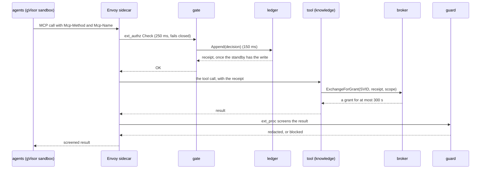

# Loan migration platform

> **This is a design shell of sample files.** Every source file is a comment that says what goes there and what it may import. The manifests (`package.json`, `pyproject.toml`, `pnpm-workspace.yaml`) list each service's open-source libraries and versions. There is no implementation and no customer data.

A platform that moves a 30-year-old bank's loan book (Oracle records, OnBase documents, loose PDFs and forms) into a new platform's database. AI agents do the first 80 percent of the mapping work, and people approve the rest. Every agent action passes one gate, and the gate writes the decision down before the action happens.

Start with [docs/ARCHITECTURE.md](docs/ARCHITECTURE.md), then [services/gate](services/gate), the service everything else depends on.

## Services

Twelve bounded contexts become fifteen services in five trust zones, plus an adopted model gateway. A zone is a namespace, a network policy and a set of credentials. The enforcement context runs as four processes, because each one holds a different key.

| Zone           | Service                                        | Language   | Job                                                                                                                                                     |
| -------------- | ---------------------------------------------- | ---------- | ------------------------------------------------------------------------------------------------------------------------------------------------------- |
| **Raw**        | [services/intake](services/intake)             | TypeScript | Reads the legacy sources read-only, at one point in time, and lands every byte once under its hash.                                                     |
|                | [services/sanitizer](services/sanitizer)       | Python     | Strips macros and scripts, then masks identity numbers in text and in the image, before anything else reads a file.                                     |
| **Masked**     | [services/docai](services/docai)               | Python     | Splits bundles, classifies pages into one taxonomy and extracts fields with page-and-box citations. Disagreements become flagged gaps.                  |
|                | [services/knowledge](services/knowledge)       | TypeScript | Joins application, party, document, field and the line of legacy code that writes it into one graph, and serves evidence dossiers to agents.            |
|                | [services/agents](services/agents)             | TypeScript | Runs five narrow agents as Temporal activities in a gVisor sandbox. Holds no credentials; every call leaves through Envoy.                              |
| **Gate**       | [services/gate](services/gate)                 | TypeScript | Decides every agent action against default-deny Cedar policies, writes the decision to the ledger first, and fails closed.                              |
|                | [services/ledger](services/ledger)             | TypeScript | Keeps the decision log: append-only, hash-chained, durable on a synchronous standby before it answers, checkpointed to WORM storage.                    |
|                | [services/broker](services/broker)             | TypeScript | Trades a SPIFFE identity plus a ledger receipt for one credential, scoped to exactly what was decided, for at most 300 seconds.                         |
|                | [services/guard](services/guard)               | Python     | Reads every tool result and prompt on the wire through Envoy's ext_proc: redacts identity numbers and flags injected instructions.                      |
|                | [deploy/model-gateway](deploy/model-gateway)   | adopted    | Routes model calls to Claude on Bedrock over PrivateLink, or to open weights on vLLM inside the bank. Pins versions per run and enforces token budgets. |
| **Control**    | [services/runs](services/runs)                 | TypeScript | Owns the order of a run: one durable workflow per migration unit that waits for people and survives restarts.                                           |
|                | [services/mapping](services/mapping)           | TypeScript | Keeps mapping specs, sends uncertain fields to their owners, reuses approved answers and compiles each spec into a PySpark job.                         |
|                | [services/staging](services/staging)           | TypeScript | Creates one masked copy of landed data per run, loads it by key range idempotently, and destroys it when the run ends.                                  |
|                | [services/verification](services/verification) | TypeScript | Climbs the ladder on every record, L0 structure to L5 downstream feeds, and stores evidence that names the exact snapshot it checked.                   |
|                | [services/release](services/release)           | TypeScript | Opens a merge request with spec, code, evidence and gaps; records approvals; refuses self-approval; needs two people on money fields.                   |
| **Production** | [services/cutover](services/cutover)           | TypeScript | Moves applications by status in small cohorts. Legacy stays the record until a parallel run matches within written tolerances. _After the pilot._       |

Every TypeScript service has the same four rings: `src/domain`, `src/application` (use cases and the ports they own), `src/adapters` and `src/main`. Imports point inward. `.dependency-cruiser.cjs` and the Nx module boundaries in `eslint.config.mjs` fail CI on a wrong import; import-linter does the same for the Python services.

## One agent call



No record, no action: if the ledger can't write, the gate denies, Envoy returns 403 and the run pauses.

## Repository layout

```
services/    fifteen services, one folder each, the four rings inside
packages/    shared-kernel, contracts, contracts-py, platform-node, platform-nest, testing
contracts/   protobuf and AsyncAPI: every format that crosses a service boundary
policies/    the Cedar policies agents run under, with a test case per rule
jobs/        PySpark: parsing, profiling, entity resolution, loading, the verification ladder
deploy/      Helm, Envoy, Cilium, SPIRE, OpenBao, the model gateway, Terraform, the air-gap bundle
tests/       the tracer bullet and the chaos suites
tools/       the service generator and scripts
docs/        architecture, decisions, reliability, testing and tech debt
```

## Stack

Every open-source part, at the version the repo installs on 2026-10-29: the newest release that is at least a week old. Exact npm versions are in the catalog in [pnpm-workspace.yaml](pnpm-workspace.yaml); Python versions are in each `pyproject.toml`. Why each one beat its alternative is in [docs/adr](docs/adr).

| Area                   | Parts                                                                                                                                                                                                                                                                                                                                                                                              |
| ---------------------- | -------------------------------------------------------------------------------------------------------------------------------------------------------------------------------------------------------------------------------------------------------------------------------------------------------------------------------------------------------------------------------------------------- |
| Runtime & framework    | Node.js LTS 24 · NestJS 12.2 · Fastify adapter 5.12 · TypeScript 6.0 · SWC 1.16                                                                                                                                                                                                                                                                                                                    |
| Contracts & validation | Buf CLI 1.75 · protobuf-es 2.16 · Connect-ES 2.2 · AsyncAPI CLI 6.2 · Zod 4.6 · @nestjs/swagger 12.0                                                                                                                                                                                                                                                                                               |
| Data access            | Kysely 0.29 · node-pg-migrate 9.0 · node-postgres 8.23 · pg-copy-streams 7.0 · neo4j-driver 6.2 · DuckDB Node 1.5.6 · AWS SDK · S3 3.1155 · AWS SDK · RDS 3.1155 · AWS SDK · KMS 3.1155                                                                                                                                                                                                            |
| Messaging & workflow   | Confluent Kafka JS 1.11 · Schema Registry client 1.11 · Temporal TS SDK 1.24 · Temporal × AI SDK 1.0                                                                                                                                                                                                                                                                                               |
| Identity & policy      | Cedar (WASM) 4.14 · cedar-for-agents 0.7 · jose 6.2 · node-vault 0.13 · sigstore-js 5.0                                                                                                                                                                                                                                                                                                            |
| Agents (SDKs)          | AI SDK 7.0 · AI SDK · OpenAI-compatible 3.0 · MCP TypeScript SDK 2.3                                                                                                                                                                                                                                                                                                                               |
| Resilience & telemetry | OpenTelemetry JS 3.0 · pino + nestjs-pino 10.4 · cockatiel 4.0                                                                                                                                                                                                                                                                                                                                     |
| Integrations           | undici 8.12 · Unleash SDK 6.12 · antlr4ng 3.0                                                                                                                                                                                                                                                                                                                                                      |
| Build, test & lint     | pnpm 12.16 · Nx 24.0 · dependency-cruiser 18.7 · Vitest 5.0 · Testcontainers 12.2 · Pact JS 17.1 · fast-check 4.10 · Biome 2.6 · typescript-eslint 8.72 · Toxiproxy 4.1                                                                                                                                                                                                                            |
| Python workers         | Temporal Python SDK 1.35 · Pydantic 2.14 · Docling 2.144 · pikepdf 10.17 · oletools 0.60 · Magika 1.0 · Presidio 2.2 · Tesseract 5 · python-stdnum 2.2 · hvac 2.4 · pdfplumber 0.11 · PyExifTool 0.5 · PyIceberg 0.12 · grpcio 1.85 · protobuf (Python) 7.36 · confluent-kafka (Python) 2.16 · boto3 1.43 · HTTPX 0.28 · ONNX Runtime 1.31 · import-linter 2.15 · uv 0.13 · Ruff 0.17 · pytest 9.2 |
| Spark jobs             | PySpark 4.2 · Apache Iceberg · PyDeequ 1.7 · Cobrix · sqlglot 30.25 · Splink 5.0 · ProLeap COBOL parser                                                                                                                                                                                                                                                                                            |
| Platform we run        | Kubernetes · Envoy 1.40 · Cilium · gVisor + agent-sandbox 1.0 · SPIRE 1.15 · OpenBao 2.7 · Keycloak 26.8 · Apache Kafka · Debezium 3.x · Apicurio Registry 3.3 · Temporal Server · PostgreSQL · Neo4j · Ceph RGW · Apache Polaris · vLLM · Agent Router 1.2 · Spark Operator · Argilla · GitLab · Harbor · OTel Collector · Prometheus · Helm 4 · Zarf 0.88 · cosign + Syft 3.1                    |
| Models                 | Claude via Bedrock · Qwen3 on vLLM · Qwen3-VL · olmOCR · BGE-M3 · Prompt Guard 2 86M                                                                                                                                                                                                                                                                                                               |

## Design

The architecture was designed in eight passes, one question each, and every answer is written down:

| Phase                       | Recorded in                                                                                                                          |
| --------------------------- | ------------------------------------------------------------------------------------------------------------------------------------ |
| Clean Architecture          | [ARCHITECTURE.md §1](docs/ARCHITECTURE.md#1-boundaries-and-the-dependency-rule)                                                      |
| Domain-Driven Design        | [ARCHITECTURE.md §2](docs/ARCHITECTURE.md#2-contexts-and-language), [glossary](docs/glossary.md), [context map](docs/context-map.md) |
| System Design               | [ARCHITECTURE.md §3](docs/ARCHITECTURE.md#3-size)                                                                                    |
| Data-Intensive Applications | [ARCHITECTURE.md §4](docs/ARCHITECTURE.md#4-data)                                                                                    |
| Software Design             | [TECH-DEBT.md](docs/TECH-DEBT.md)                                                                                                    |
| Release It!                 | [RELIABILITY.md](docs/RELIABILITY.md)                                                                                                |
| Pragmatic Programmer        | [TESTING.md](docs/TESTING.md)                                                                                                        |
| 37signals Way               | [ARCHITECTURE.md §5](docs/ARCHITECTURE.md#5-appetite)                                                                                |

The tracker is [docs/DESIGN-CODE-ARCHITECTURE-PLAN.md](docs/DESIGN-CODE-ARCHITECTURE-PLAN.md).

Nainish Rai, October 2026.
