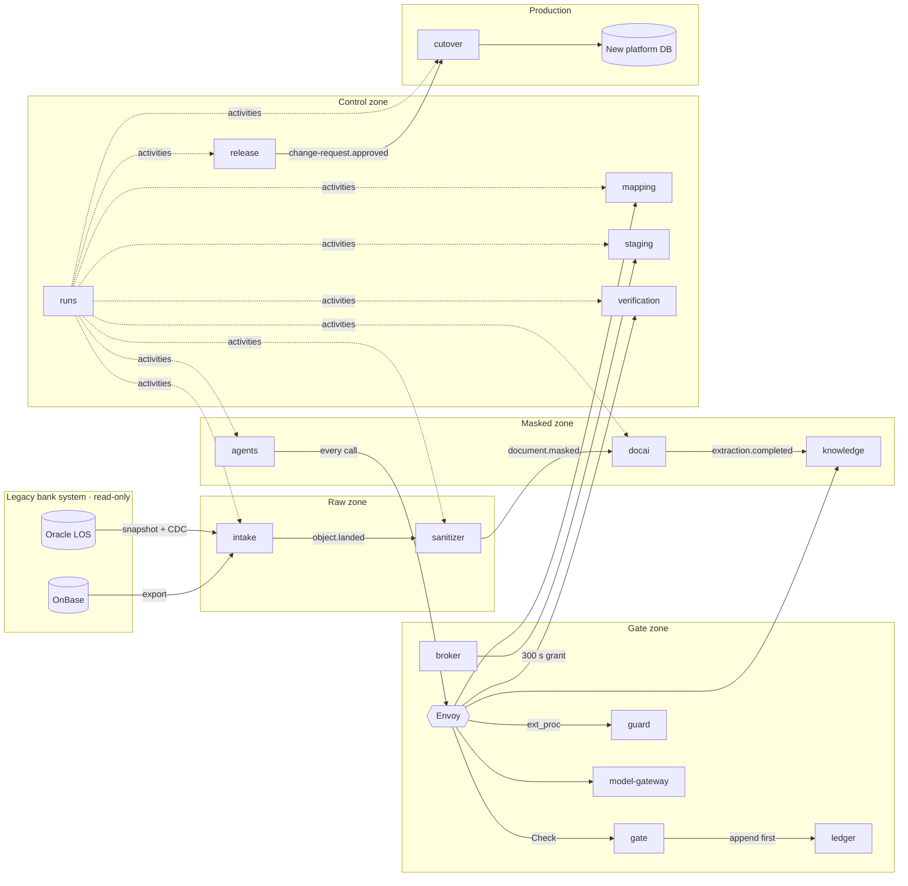

# Context map

| Upstream            | Downstream                    | Relationship          | Language                                                  |
| ------------------- | ----------------------------- | --------------------- | --------------------------------------------------------- |
| Legacy LOS, OnBase  | intake                        | Anti-corruption layer | Parsed as data; legacy names stop at intake and knowledge |
| intake              | sanitizer, docai, knowledge   | Published language    | `contracts/events/intake.yaml` (AsyncAPI)                 |
| gate                | agents, every tool service    | Open host service     | Envoy ext_authz + `policies/schema.cedarschema`           |
| ledger              | gate, broker, auditors        | Open host service     | `contracts/proto/lmp/ledger/v1`                           |
| New platform schema | mapping, staging, cutover     | Conformist            | Target schema version pinned per run                      |
| runs                | every service with activities | Customer–supplier     | `packages/contracts/src/activities`                       |
